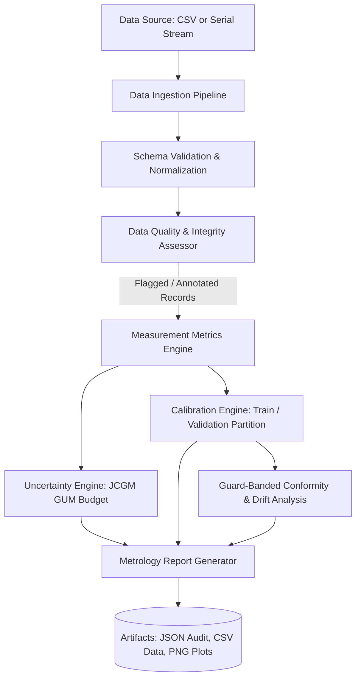

# IMUCA — System Architecture

## 1. Architectural Overview and Design Principles

The IMUCA framework is structured around five core architectural principles:

1. **Separation of Concerns**: Scientific metrology, uncertainty propagation, and calibration routines are decoupled from data ingestion, persistent storage, and visualization interfaces.
2. **Immutability of Raw Measurements**: Ingested datasets and live serial frames are never altered in-place. All transformations, diagnostic flags, and calibrated values are written to separate data columns and files.
3. **Reproducibility by Design**: Deterministic pseudo-random number generators with explicit seeds, frozen configuration files, and self-contained execution pipelines ensure identical outputs across environments.
4. **Hardware Decoupling via Unified Stream Interfaces**: Data ingestion is mediated by an abstract interface capable of processing offline CSV files and live serial packets interchangeably.
5. **Traceable Quality Auditing**: Every record carries an audit bitmask/flag string, allowing engineers to inspect flagged anomalies without data loss.

---

## 2. Directory and Component Map

```
IMUCA/
├── config/
│   └── default_config.json          # Metrological limits, tolerances, sampling rates, seed
├── docs/                            # Metrological specifications, architectures, budgets
├── data/
│   ├── raw/                         # Untouched external CSV files
│   ├── processed/                   # Processed outputs with calibration & quality tags
│   └── synthetic/                   # Ground-truth separated synthetic datasets & metadata
├── src/
│   └── imuca/                       # Importable Metrology Package
│       ├── __init__.py              # Public API re-exports
│       ├── schema.py                # Data model, frozen dataclasses, SI unit conversions
│       ├── data_ingestion.py        # CSV loader, column normalization, stream buffer
│       ├── data_quality.py          # MAD outlier, sequence gaps, timing jitter, confusion matrix
│       ├── synthetic_data.py        # Ground-truth separated simulation engine
│       ├── measurement_metrics.py   # Bias, MAE, RMSE, (n-1) std dev, repeatability, residuals
│       ├── uncertainty.py           # JCGM GUM Type A/B, shunt model, Welch-Satterthwaite, MC
│       ├── calibration.py           # Linear, polynomial, F-test model selection, train/test split
│       ├── validation.py            # ILAC-G8 guard-banded conformity, drift tracking, CUSUM
│       └── reporting.py             # JSON reports, publication plots, markdown summaries
├── tests/                           # Comprehensive Pytest suite
│   ├── test_schema.py
│   ├── test_data_quality.py
│   ├── test_measurement_metrics.py
│   ├── test_uncertainty.py
│   ├── test_calibration.py
│   └── test_validation.py
├── scripts/
│   └── run_baseline_experiment.py   # Multi-measurand benchmark runner
└── results/                         # Generated plots, JSON records, and markdown reports
```

---

## 3. Data Flow and Processing Pipeline



### Detailed Pipeline Stages:
1. **Stage 1 (Ingestion & Schema)**: Raw data enters through `DataIngestionPipeline.load_csv()` or `MeasurementStreamBuffer.push_raw_line()`. Column headers are normalized to canonical schema.
2. **Stage 2 (Quality & Non-Destructive Screening)**: `DataQualityAssessor.assess()` evaluates sequence monotonicity, missing samples, non-finite values, and flags outliers via Median Absolute Deviation (MAD). Suspicious records are retained and flagged.
3. **Stage 3 (Metrics & Repeatability)**: `compute_descriptive_statistics()` calculates mean, sample standard deviation with $(n-1)$ Bessel correction, standard error, and Student's t confidence intervals.
4. **Stage 4 (GUM Uncertainty Propagation)**: `build_uncertainty_budget()` combines Type A repeatability with Type B sources (resolution, manufacturer specs, reference instrument, thermal gradients, shunt resistor tolerances) using first-order Taylor expansion and Welch-Satterthwaite degrees of freedom.
5. **Stage 5 (Calibration & Out-of-Sample Validation)**: `CalibrationEngine.evaluate_train_validation_split()` partitions data, fits linear or polynomial models on training points, performs an F-test to verify polynomial justification, and tests on independent validation points.
6. **Stage 6 (Conformity & Drift)**: `evaluate_guard_banded_conformity()` enforces ILAC-G8 guard bands. `analyze_temporal_drift()` estimates linear drift rate, forecasts time-to-breach, and runs CUSUM shift detection.
7. **Stage 7 (Export & Visualisation)**: `MetrologyReportGenerator` saves JSON audit logs, Markdown summaries, and matplotlib plots to `results/`.

---

## 4. Hardware Integration Interface (Microcontroller Roadmap)

The physical microcontroller (ESP32 / Arduino C/C++) will stream telemetry over UART serial or USB CDC.
The interface contract is defined by `MeasurementStreamBuffer`:

```python
# Streaming acquisition loop (prepared for pyserial integration)
buffer = MeasurementStreamBuffer(buffer_size=1000)

# Serial packets can arrive as comma-delimited ASCII or JSON
# Format: <seq>,<elapsed_ms>,<voltage_V>,<current_mA>,<temperature_C>,<status>
success, record, msg = buffer.push_raw_line("101,101000,5.012,245.3,24.18,OK")
```

When physical hardware becomes available, the serial driver will plug directly into `push_raw_line` without requiring modifications to the underlying metrology, uncertainty, or calibration algorithms.
